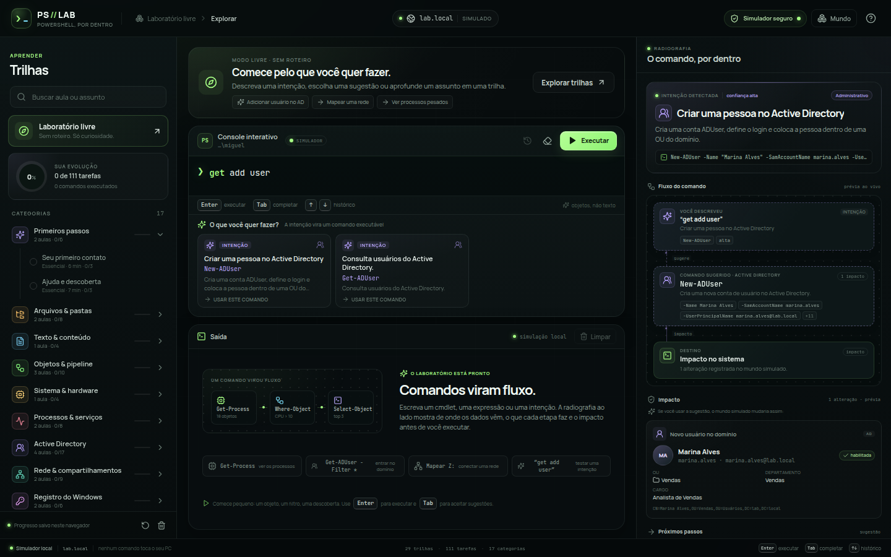
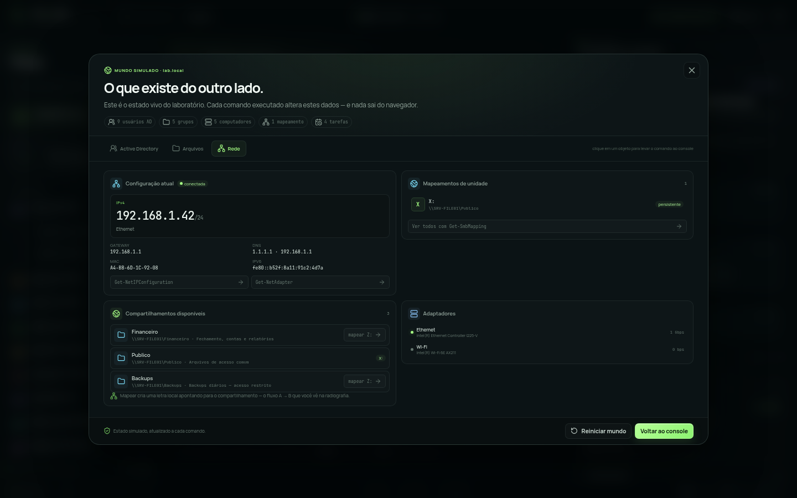
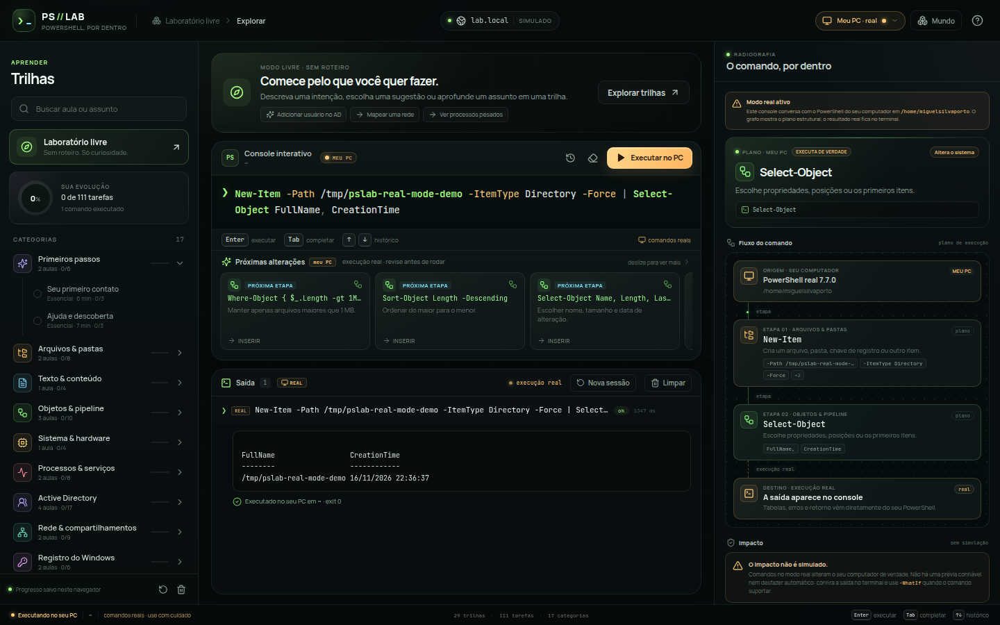
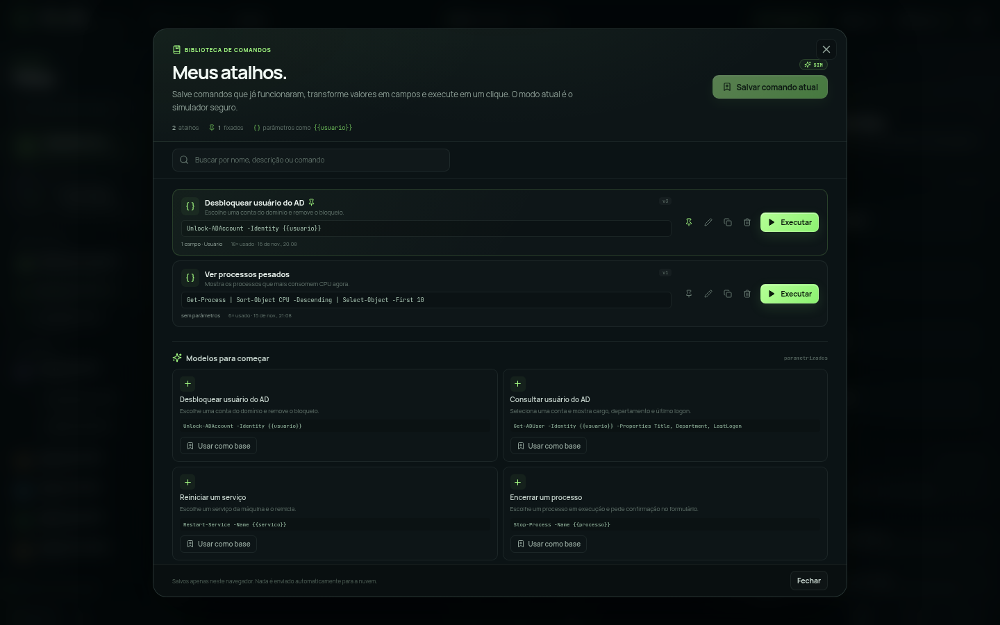
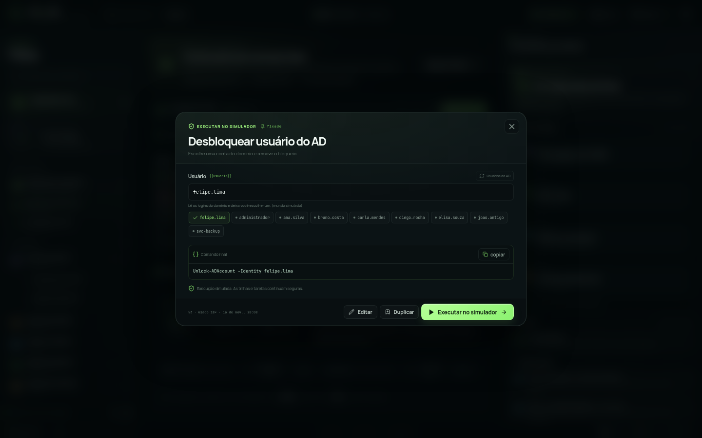

# PS Lab — PowerShell, por dentro

Um laboratório interativo para aprender PowerShell **vendo cada comando virar um fluxo**.

O PS Lab combina um console com sugestões em tempo real, um grafo no estilo N8N que mostra origem → etapas → destino, um mundo simulado com Active Directory e um mapa visual do impacto antes de qualquer alteração.

O **simulador é o modo padrão**. Quando quiser, você pode ativar o modo **Meu PC** e executar comandos de verdade em um PowerShell local — com confirmação explícita e aviso de risco.



## O que já funciona

- **Editor com sugestões contextuais** — comandos, parâmetros, valores, próximas etapas de pipeline e intenções em linguagem natural.
- **Ghost text** — complete o comando com `Tab` enquanto digita.
- **Intenções** — frases como `get add user`, `mapear unidade de rede` ou `contas bloqueadas` apontam para um cmdlet executável.
- **Radiografia do comando** — cada etapa do pipeline aparece como um bloco do grafo, com contagem de objetos, parâmetros e erros.
- **Impacto antes/depois** — cartões visuais para criação de usuários no AD, mapeamento de unidades, mudanças no registro, serviços, tarefas, arquivos e mais.
- **29 trilhas guiadas em 17 categorias** — 111 tarefas validadas por padrão de comando e, quando necessário, pelo estado real do mundo simulado.
- **Mundo simulado navegável** — domínio `lab.local`, pessoas, grupos, computadores, árvore de arquivos, compartilhamentos e unidades mapeadas.
- **Biblioteca de atalhos** — salve comandos que funcionaram, fixe os mais usados na barra lateral, edite, crie variações por duplicação e transforme valores em campos `{{parâmetro}}`.
- **Sugestões de valores** — em vez de decorar nomes, escolha um usuário do AD, processo, serviço ou grupo em uma lista lida do simulador ou do seu PC.
- **Ajuda por comando** — o botão “?” de cada sugestão abre uma referência com resumo, risco, parâmetros e exemplos prontos para inserir no console.
- **Erros bilíngues** — mensagens reais do PowerShell aparecem no original em inglês, com tradução para português e uma dica do que fazer.
- **Persistência local** — progresso, mundo, histórico do simulador e atalhos ficam no navegador.
- **Modo real opcional** — conecta o console ao PowerShell do computador, com consentimento, indicador permanente de execução real e sem desfazer automático.
- **Aulas sempre seguras** — as tarefas das trilhas são validadas contra o simulador; o modo real é para explorar o seu próprio ambiente.



## Rodar o laboratório

Requisito: **Node.js 20 ou superior**.

```bash
npm install
npm run dev
```

Abra `http://localhost:5173`.

O projeto é escrito em **JavaScript puro + JSX** e roda direto no servidor de desenvolvimento do Vite, com atualização instantânea (HMR). Não existe etapa manual de compilação para testar. O `npm run build` é opcional, apenas para gerar uma versão de produção.

> O modo real depende desse servidor local (`npm run dev`) e fica disponível apenas para conexões loopback. Ele não existe no `vite preview` estático.

### Testes

```bash
npm test     # 587 verificações das trilhas, simulador, intenções, atalhos e sugestões
npm run build
```

Ou os dois de uma vez:

```bash
npm run check
```

## Modo real: Meu PC



O laboratório começa no **Simulador**. Para executar de verdade:

1. Clique no seletor **Simulador** no topo.
2. Escolha **Meu PC**.
3. Marque a confirmação e clique em **Ativar modo real**.

A partir daí, o console usa uma sessão persistente do PowerShell da máquina:

- variáveis e diretório atual sobrevivem entre comandos;
- a saída, erros e `exit code` são reais;
- o terminal marca execuções com `REAL` e o topo fica permanentemente em alerta;
- o painel de fluxo mostra o **plano estrutural** do comando, sem inventar um impacto simulado;
- as trilhas continuam disponíveis, mas as tarefas não são validadas nesse modo;
- a sessão começa na sua pasta pessoal, usa `-NoProfile`, roda com o seu usuário e não eleva privilégios automaticamente.

**Isto não é um sandbox.** Os comandos rodam com as permissões do seu usuário e podem criar, alterar ou apagar arquivos, processos e configurações. Use `-WhatIf` quando o cmdlet suportar e não cole comandos de fontes desconhecidas. O modo real não é salvo: recarregar a página volta ao simulador.

### Instalar o PowerShell

O modo real é detectado automaticamente em:

1. `PSLAB_PWSH` (caminho explícito);
2. `.tools/pwsh/pwsh` dentro do projeto;
3. `pwsh` no `PATH` (ou `powershell.exe` no Windows, como fallback).

Neste workspace, o PowerShell 7.7.0 foi instalado em `.tools/pwsh` apenas para uso local e está no `.gitignore`. Em outra máquina, instale o **PowerShell 7** pelo instalador oficial (ou `winget install Microsoft.PowerShell` no Windows) e reinicie o `npm run dev`. O modal de modo mostra o caminho detectado e oferece **Verificar novamente**.

O servidor local de execução:

- aceita apenas conexões de loopback;
- exige um cabeçalho próprio e a mesma origem;
- mantém no máximo três sessões, com timeout de 30 s por comando;
- limita o tamanho da saída e não persiste comandos em log.

## Atalhos reutilizáveis



O atalho começa de um comando que você já testou. Execute-o no console, clique no ícone de marcador ao lado do botão **Executar** (ou use **Atalhos → Salvar comando atual**) e dê um nome. Na edição, troque os valores que mudam por campos:

```powershell
Unlock-ADAccount -Identity {{usuario}}
Restart-Service -Name {{servico}}
Get-ChildItem {{caminho}} -Recurse
```

O editor detecta cada `{{parâmetro}}` e permite escolher uma fonte de sugestões. Ao executar, o formulário carrega as opções e monta o comando final antes de rodar:

| Fonte | Exemplos de valores |
| --- | --- |
| Usuários do AD | `ana.silva`, `felipe.lima` |
| Contas locais | contas da própria máquina |
| Grupos do AD / locais | grupos do domínio ou do computador |
| Processos | processos em execução |
| Serviços | serviços instalados |
| Computadores do AD | nomes registrados no domínio |
| Tarefas agendadas | tarefas do Windows |
| OUs do AD | DNs das unidades organizacionais |

Fluxo típico de um atalho como **Desbloquear usuário do AD**:

1. Abra **Atalhos** ou clique no atalho fixado na barra lateral.
2. Digite parte do login ou escolha `felipe.lima` na lista.
3. Confira o comando final: `Unlock-ADAccount -Identity felipe.lima`.
4. Execute no simulador — ou, no modo **Meu PC**, execute de verdade com a confirmação de risco já exibida.



Cada atalho guarda a última seleção, a contagem de execuções, a data do último uso e o estado **fixado**. Na biblioteca você pode **editar** (a versão sobe), **duplicar** para criar uma variação, **fixar/desafixar** e **excluir** com confirmação.

No modo real, as listas são lidas do seu computador pelo PowerShell. Se o módulo do Active Directory (RSAT) não estiver instalado, a consulta mostra o erro e o campo continua editável para você digitar o valor manualmente. Os atalhos ficam apenas no `localStorage` deste navegador, em `pslab.shortcuts.v1`, e não são enviados para a nuvem.

## Ajuda por comando e tradução de erros

Cada sugestão que representa um cmdlet tem um botão **“?”**. Ele abre uma referência com:

- resumo do comando e categoria;
- nível de risco e tipo de saída;
- aliases e parâmetros principais;
- exemplos prontos, com **Copiar** e **Inserir no console**.

Inserir um exemplo não executa nada: apenas coloca o texto no editor para revisão.

No modo real, quando o PowerShell devolve um erro em inglês, o terminal preserva a mensagem original e mostra abaixo uma **tradução para português**, com uma dica do que verificar. A tradução é feita localmente, sem enviar caminhos, usuários ou mensagens do seu PC para serviços externos. Mensagens já em português não recebem tradução duplicada.

## Categorias

| Categoria | O que você pratica |
| --- | --- |
| Primeiros passos | Orientação, ajuda e descoberta de comandos |
| Arquivos & pastas | Navegação, criação, cópia, movimentação e remoção segura |
| Texto & conteúdo | Leitura, escrita e busca com `Select-String` |
| Objetos & pipeline | `Where-Object`, `Select-Object`, `Sort-Object`, `Measure-Object`, `ForEach-Object`, `Group-Object` |
| Sistema & hardware | `Get-ComputerInfo`, CIM/WMI, volumes e atualizações |
| Processos & serviços | Inspeção, consumo, encerramento e controle de serviços |
| Active Directory | Domínio, usuários, grupos, computadores, OUs, filtros e ciclo de vida de contas |
| Rede & compartilhamentos | IP, DNS, rotas, ping, portas, SMB e mapeamento de unidades |
| Registro do Windows | HKCU, HKLM, leitura e alteração de valores |
| Módulos & galeria | Módulos carregados, galeria, instalação e importação |
| Automação agendada | Tarefas, gatilhos e execução imediata |
| Remoting | WinRM, sessões remotas e `Invoke-Command` |
| Segurança & contas | Política de execução, assinaturas e contas locais |
| Dados & relatórios | CSV, JSON e pipelines que geram relatórios |
| Erros & depuração | Mensagens, `$Error`, `-ErrorAction` e try/catch |
| Variáveis & operadores | Variáveis, interpolação, contas e objetos guardados |
| Ambiente & perfil | Variáveis de ambiente, versão, histórico e sessão |

## Active Directory no laboratório

O domínio é fictício, mas a mecânica é a mesma:

```powershell
Get-ADDomain
Get-ADUser -Filter *
Get-ADUser -Filter "Department -eq 'Vendas'"
Get-ADGroupMember -Identity TI-Suporte
Search-ADAccount -LockedOut
Unlock-ADAccount -Identity felipe.lima
New-ADUser -Name "Lara Martins" -SamAccountName lara.martins `
  -UserPrincipalName lara.martins@lab.local `
  -Path "OU=Vendas,OU=Usuários,DC=lab,DC=local" -Enabled $true
Add-ADGroupMember -Identity VPN-Users -Members lara.martins
```

Cada execução atualiza o explorador **Mundo** e o painel de impacto. As quatro trilhas de Active Directory vão de exploração e filtros até criação de conta, grupos e organização por OUs.

## Rede e mapeamentos

A trilha de rede mostra o fluxo A → B com clareza:

```powershell
Get-SmbShare
Get-SmbMapping
New-SmbMapping -RemotePath "\\\\SRV-FILE01\\Financeiro" -LocalPath Z: -Persistent $true
Get-ChildItem Z:\
Get-PSDrive
```

O foco é **criar, entender e auditar** mapeamentos. O laboratório também conhece `Remove-SmbMapping`, mas a trilha evita transformar desconexão em rotina e destaca o impacto no painel.

## Como as sugestões pensam

1. **Intenção** — normaliza português/inglês, sinônimos e verbos (`adicionar`, `add`, `criar`, `mapear`) e encontra um cmdlet executável.
2. **Comando** — busca fuzzy por nome, alias e substantivo.
3. **Parâmetro** — prioriza obrigatórios que ainda faltam e mostra a descrição.
4. **Valor** — usa dados do mundo simulado (usuários, grupos, processos, serviços, compartilhamentos, OUs).
5. **Próxima etapa** — sugere filtros, ordenação, projeção, medição e verificação de impacto.

O `Tab` aceita o texto fantasma. Clique em qualquer cartão de sugestão para inseri-lo no console. O comando continua no editor depois de executado, então você pode iterar e adicionar o próximo pipe.

## Atalhos

| Tecla | Ação |
| --- | --- |
| `Enter` | Executar o comando |
| `Tab` | Aceitar ghost text / sugestão inline |
| `↑` `↓` | Navegar no histórico da sessão |
| `Esc` | Sair do editor ou fechar um modal |

## Estrutura

```text
src/
  components/        interface: console, fluxo, modais, trilhas, mundo
  data/
    catalog.js       catálogo de 124 cmdlets simulados + metadados
    intents.js       intenções em linguagem natural
    lessons.js       29 aulas, 111 tarefas e verificações de estado
    seed.js          mundo inicial: filesystem, AD, rede, registro
    shortcuts.js     modelos, placeholders e fontes de valores dos atalhos
  editor/            linguagem PowerShell para o CodeMirror
  engine/
    parser.js        pipelines, strings, parâmetros e scriptblocks
    simulator.js     executor simulado e efeitos visuais
    suggestions.js   intenções, completions, ghosts e próximos passos
    errorTranslator.js tradução local de mensagens de erro do PowerShell
  App.jsx            estado da sessão, progresso, atalhos e integração
  styles.css         design system e layout responsivo
server/
  bridge.ps1        loop persistente que executa comandos no pwsh real
  realPowerShell.mjs serviço de sessões, timeout e proteção local
  viteRealPowerShellPlugin.mjs endpoints /api/pwsh/* do Vite
scripts/test.mjs     suíte de verificação sem compilação
docs/                capturas usadas neste README
```

## Limites e próximos passos

- O **simulador** cobre o catálogo de 124 cmdlets e as 29 trilhas. Ele não executa efeitos reais.
- O **modo real** executa comandos no seu usuário, mas não é um sandbox, não tem desfazer automático e não é persistido entre recarregamentos. Comandos interativos podem atingir o timeout de 30 s.
- As listas de atalhos no modo real dependem dos módulos disponíveis: Active Directory exige RSAT; contas e grupos locais variam entre Windows, Linux e macOS. Quando a consulta falha, o valor ainda pode ser digitado à mão.
- O modo real foi pensado para `npm run dev` local; não há backend de execução no build estático.
- O catálogo e o mundo simulado cobrem o essencial; novos módulos podem ser adicionados em `src/data/catalog.js` e no simulador.
- O mundo, progresso, histórico e atalhos ficam no `localStorage`; limpar os dados do site reinicia o laboratório e apaga os atalhos salvos.
- Roadmap natural: execução real no Windows com módulos RSAT/AD, auditoria de comandos, confirmação por comando destrutivo, mais objetos de AD, eventos, certificados e Microsoft Graph.

## Repositório

[github.com/MiguelSilvaPorto/powershell-lab](https://github.com/MiguelSilvaPorto/powershell-lab)

Este projeto é um laboratório pessoal de aprendizagem construído em JavaScript, com foco em clareza visual do modelo de objetos e do pipeline do PowerShell.
